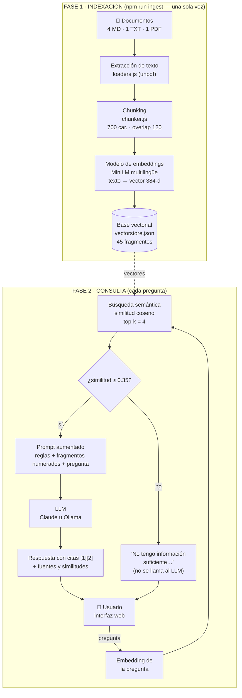

# Arquitectura y flujo de funcionamiento del RAG

## Diagrama de arquitectura



Si el visor no muestra el diagrama Mermaid, este es el mismo flujo en texto:

```
INDEXACIÓN:  Documentos → Extracción → Chunking → Embeddings → Base vectorial
CONSULTA:    Pregunta → Embedding → Búsqueda (coseno, top-k) → ¿Umbral? ─ no → "No tengo información"
                                                                     └ sí → Prompt + fragmentos → LLM → Respuesta + fuentes
```

## Componentes

| Capa | Archivo | Qué hace |
|---|---|---|
| Carga | `src/loaders.js` | Lee `.md` y `.txt` como texto; en los PDF extrae el texto página por página con `unpdf`. |
| Chunking | `src/chunker.js` | Divide el texto en secciones y fragmentos con solapamiento, y guarda metadatos (documento, sección, página). |
| Embeddings | `src/embeddings.js` | Convierte texto en vectores con un modelo local (ONNX), sin depender de una API. |
| Base vectorial | `src/vectorStore.js` | Guarda los vectores y busca por similitud coseno. |
| Orquestación RAG | `src/rag.js` | Embedding de la pregunta → búsqueda → filtro por umbral → prompt → LLM. |
| LLM | `src/llm.js` | Se conecta con Claude (SDK de Anthropic) u Ollama (local). |
| API web | `src/server.js` | `POST /api/preguntar`, `GET /api/info`, `GET /api/fragmentos`. |
| Interfaz | `public/index.html` | Pregunta, respuesta con citas, fuentes con barra de similitud, pasos del proceso y visor de fragmentos. |

---

## 1. Chunking (división en fragmentos)

**¿Por qué dividir?** Hay tres razones:
1. El modelo de embeddings representa mejor textos cortos y de un solo tema. Un vector para un documento completo "promedia" muchos temas y pierde precisión.
2. Al LLM solo se le envía lo relevante, lo que ahorra *tokens* y reduce el ruido.
3. Las citas son más precisas, porque apuntan a una sección y no a un documento entero.

**Nuestra estrategia (divisor recursivo con solapamiento):**
1. **Por secciones:** primero se corta en los títulos (`#` en Markdown; líneas en MAYÚSCULAS o numeradas como "2. Integridad académica" en TXT y PDF). En los PDF, además, se unen los renglones para reconstruir los párrafos completos. Así un fragmento nunca mezcla, por ejemplo, "Multas" con "Horarios", y cada fragmento conserva el nombre de su sección.
2. **Corte recursivo:** si una sección pasa de 580 caracteres (700 − 120 de overlap), se intenta cortar por párrafos (`\n\n`); si un párrafo sigue siendo muy largo, por líneas; luego por oraciones (`. `) y, como último recurso, por palabras. Así se respetan las fronteras naturales del texto.
3. **Solapamiento (overlap) de 120 caracteres:** cada fragmento empieza con el final del anterior. Si una idea quedó partida entre dos fragmentos, ninguno de los dos pierde el contexto.
4. **Título como contexto del embedding:** al vectorizar se antepone el título de la sección (por ejemplo, `"Beca de Excelencia Académica: Cobertura 100 %…"`), así el vector "sabe" de qué trata el fragmento.

**Parámetros elegidos: 700 caracteres con 120 de overlap** (≈ 150–180 *tokens*). Resultado: **6 documentos → 45 fragmentos**.

**¿Cómo elegimos el tamaño? Con un experimento.** Medimos, para las 13 preguntas de prueba, si **el dato que responde la pregunta** (por ejemplo, "70" o "$450") aparece en alguno de los fragmentos recuperados:

| Tamaño / overlap | Fragmentos | Dato recuperado con top-4 | Dato recuperado con top-6 |
|---|---|---|---|
| 400 / 80 | 60 | 12 / 13 | 13 / 13 |
| 500 / 100 | 54 | 11 / 13 | 13 / 13 |
| **700 / 120** | **45** | **13 / 13** | 13 / 13 |
| 900 / 150 | 45 | 13 / 13 | 13 / 13 |

Con fragmentos pequeños (500), la oración "La calificación mínima aprobatoria es 70" quedaba en un fragmento separado del resto de su sección y no entraba en el top-4. El LLM entonces respondía, correctamente según lo que recibió, que "no se especifica". Con 700 caracteres, la sección completa cabe en un fragmento. Más grande (900) ya no mejora y hace los prompts más largos. **Lección: la calidad del RAG depende más de la recuperación que del LLM.**

> En la pestaña **"Fragmentos (chunking)"** de la aplicación se pueden ver los 45 fragmentos, su sección, su longitud y los primeros números de su vector.

## 2. Embeddings

- **Modelo:** `paraphrase-multilingual-MiniLM-L12-v2` (Sentence-Transformers, versión ONNX de Xenova). Es multilingüe, así que funciona bien en español, y lo entrenaron específicamente para que paráfrasis queden cerca.
- **Dimensión:** 384 números por texto.
- **Cómo se obtiene un vector:** el *tokenizer* parte el texto en *tokens* y el Transformer produce un vector por *token*. Luego se **promedian** todos (*mean pooling*) y el resultado se **normaliza** a longitud 1.
- **Se ejecuta localmente:** no tiene costo por uso, funciona sin internet después de la primera descarga (~120 MB) y los documentos no salen de la computadora durante la indexación.
- **Regla clave:** la pregunta y los documentos deben vectorizarse con **el mismo modelo**; si no, los vectores no son comparables.

## 3. Búsqueda semántica

1. La pregunta se convierte en vector (≈ 10 ms).
2. Se calcula la **similitud coseno** con los 45 vectores guardados:

   `cos(A, B) = (A · B) / (|A| · |B|)`

   Como todos los vectores están normalizados (|A| = |B| = 1), basta con el **producto punto**.
3. Se ordenan de mayor a menor y se toman los **top-k = 4**.
4. Se descartan los que no llegan al **umbral de 0.35**.

**Ejemplos reales de nuestra base:**

| Pregunta | Mejor fragmento | Similitud | Resultado |
|---|---|---|---|
| ¿Cuánto cuesta un examen extraordinario? | reglamento_academico.md › Capítulo 3. Exámenes extraordinarios | **0.829** | Responde |
| ¿Cómo se llama la red wifi para alumnos? | servicios_tecnologicos.md › Red inalámbrica (Wi-Fi) | **0.846** | Responde |
| ¿Cuánto es la multa por entregar tarde un libro? | biblioteca.txt › MULTAS | **0.743** | Responde (aunque no comparte las mismas palabras) |
| ¿Cuál es la capital de Francia? | (tramites_y_titulacion.md) | **0.157** | Se abstiene sin llamar al LLM |
| ¿Quién ganó el mundial de 2022? | (becas_y_apoyos.md) | **0.282** | Se abstiene sin llamar al LLM |

**Sobre la base vectorial:** implementamos una base vectorial propia con índice **plano** (*flat*): compara contra todos los vectores, igual que `IndexFlatIP` de FAISS. Con 45 fragmentos tarda menos de 1 ms. Para millones de vectores se usaría una base como Chroma, Qdrant o pgvector con índices aproximados (**HNSW**), que encuentran los vecinos más cercanos sin comparar contra todos. La interfaz de `VectorStore` (`add`, `search`, `save`, `load`) permite cambiarla sin tocar el resto del código.

## 4. Generación con el LLM

El prompt que se envía al LLM tiene tres partes. Se puede ver completo en la app, en "Ver el prompt que se envió al LLM":

1. **System prompt con reglas:** responder **solo** con los fragmentos, citar con `[n]` y, si no hay información, responder con la frase exacta *"No tengo información suficiente en los documentos para responder esa pregunta."*
2. **Fragmentos numerados** con su ubicación: `[1] (biblioteca.txt › MULTAS) …`
3. **La pregunta** del usuario.

Proveedores: **Claude** (SDK oficial de Anthropic) u **Ollama** (local), elegidos con `LLM_PROVIDER` en `.env`.

## 5. ¿Cómo reconoce que no tiene información suficiente?

Usa **dos capas**:

| Capa | Detecta | Ejemplo |
|---|---|---|
| **1. Umbral de similitud** (antes del LLM) | Preguntas **fuera del tema** de los documentos | "¿Cuál es la capital de Francia?" → máx. 0.157 < 0.35 → se abstiene y **no gasta** una llamada al LLM. |
| **2. Instrucción en el system prompt** (en el LLM) | Preguntas **del mismo tema** cuyo dato no existe | "¿Cuánto gana el director?" → recupera fragmentos sobre el instituto (0.56), pero ninguno habla de salarios → el LLM responde la frase de "no tengo información". |

La segunda capa es necesaria porque la similitud mide **parecido de tema**, no si el fragmento **contiene la respuesta**.

## 6. Resultados de la prueba automática

La prueba (`src/pruebas.js`) tiene 18 preguntas: 13 cuya respuesta está en los documentos, cada una con el **dato** que debe aparecer en la respuesta, y 5 que no están (la app debe abstenerse).

`npm run evaluar -- --solo-busqueda` (solo recuperación, sin LLM):
- **13 de 13:** el fragmento que contiene el dato correcto estuvo entre los 4 recuperados.
- **3 de 5** preguntas sin respuesta se filtraron con el umbral (capa 1). Las 2 restantes ("¿Cuánto gana el director?", "¿Tiene alberca olímpica?") son del mismo tema, así que le tocan al LLM (capa 2).

`npm run evaluar` (completa, con **Ollama + llama3.2**): **18 de 18**.
- Las 13 respuestas contienen el dato correcto (70, 20 %, $450, 92, 1 al 15 de agosto, 8:00 a 14:00, 8 pesos, ITVS-Alumnos, C-04, 480 horas, tesis, autorización del docente, calificación de 0).
- Las 5 preguntas sin respuesta se abstuvieron: 3 por el umbral y 2 por el LLM.
